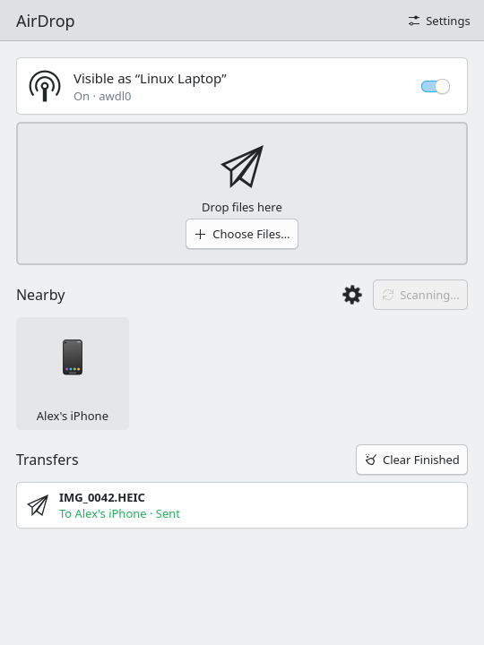
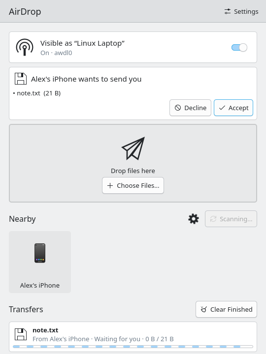
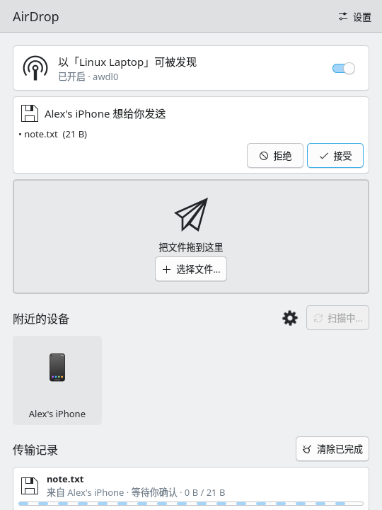

# kowly

AirDrop for KDE Plasma: send files to and receive files from iPhones, on [Owly](https://github.com/t4t5/owly).

<table>
  <tr>
    <td></td>
    <td></td>
  </tr>
  <tr>
    <td align="center">Sending</td>
    <td align="center">Receiving</td>
  </tr>
</table>

- **Send**: drop files on the window, or straight onto a device, or right-click them in Dolphin and choose *Send with AirDrop*.
- **Receive**: an iPhone's request appears as a card to accept or decline. When the window isn't in front, a desktop notification asks instead, with the same two buttons.
- **Control**: one switch takes the radio and gives it back. The window shows the AWDL peers nearby and each transfer's progress.
- **English and Chinese**: follows the system's language, or choose one in Settings.

## How it works

```
Qt/QML window (Kirigami)                qml/Main.qml
  └─ cxx-qt bridge (Backend QObject)    src/bridge.rs
       └─ engine (tokio, no Qt)          src/airdrop/
            ├─ owly-airdrop   discovery, sending, receiving (Owly's crate, linked in)
            ├─ owlyd::api     the radio, leased from owlyd over the system bus
            ├─ BlueZ          the BLE advert that wakes iPhones
            └─ notifications  org.freedesktop.Notifications
```

Monitor mode and AWDL need root, so they stay in Owly's system service, `owlyd`. kowly runs as you. When it quits, it gives the radio back, and Wi-Fi with it.

## Install

First install **Owly**, which kowly needs for the radio: `yay -S owly` on Arch, or its `.deb` or `.rpm` from [Owly's releases](https://github.com/t4t5/owly/releases). owlyd starts on demand over D-Bus, so there's nothing to enable, and polkit lets the user at the seat take the radio without a password.

Then **kowly**, from [the releases](https://github.com/oowl/kowly/releases):

| Distribution | Package | Install |
|---|---|---|
| Arch Linux | `kowly-*-x86_64.pkg.tar.zst` | `sudo pacman -U kowly-*.pkg.tar.zst` |
| Debian 13 | `kowly_*_amd64.deb` | `sudo apt install ./owly_*.deb ./kowly_*.deb` |
| Fedora 44 | `kowly-*.x86_64.rpm` | `sudo dnf install ./owly-*.rpm ./kowly-*.rpm` |

kowly links Qt's private QML API, so each package works only with the exact Qt of the release it was built for, and depends on it. The deb is for Debian 13 alone: for another release, such as an Ubuntu with KDE Frameworks 6, build one there with `packaging/package.sh deb`. On Arch, rebuild after Qt's minor version changes; `packaging/arch/PKGBUILD` is the recipe.

### From source

For your user, without root:

```sh
git clone https://github.com/oowl/kowly && cd kowly
scripts/install.sh
```

This builds a release, installs `~/.local/bin/kowly`, adds kowly to the app launcher, and adds *Send with AirDrop* to Dolphin's context menu. `scripts/install.sh uninstall` removes them. Building needs Rust 1.88 or newer, Qt 6 (base, declarative) and Kirigami, all of which a Plasma 6 desktop has.

## Before you start

Run `owly doctor`. It says which mode Owly uses for your card and which channels it may transmit on. Owly's [hardware table](https://github.com/t4t5/owly#supported-hardware) lists the cards people have tried.

**Shared mode** (the default for most tested cards): Wi-Fi stays connected, and AWDL shares its channel.

- Wi-Fi must be connected to a network on channel 6, 44 or 149. 149 on 5 GHz works best.
- If you're online over Ethernet, keep that Wi-Fi connection from taking the default route:
  ```sh
  nmcli connection modify <connection> ipv4.never-default yes ipv6.never-default yes
  ```

**Exclusive mode**: the whole card goes to AWDL while the radio is up, with no Wi-Fi connection needed. Give your driver a complete entry in `/etc/owly/drivers.toml` with `mode = "exclusive"`, and set `allow_untested = true` in `/etc/owly/radio.toml` if the card hasn't been tested that way. Owly's README has the format.

**On the iPhone**: unlock it, and set AirDrop to *Everyone for 10 Minutes*. *Contacts Only* needs an Apple account identity that Linux can't get.

**Firewall**: allow TCP 8771 from `fe80::/10` on `awdl0`.

### Troubleshooting

- **`regdom 00`, with 44 and 149 `no-ir`**: the regulatory database is usually missing. Install it and set your country:
  ```sh
  sudo pacman -S wireless-regdb
  # uncomment your country's line in /etc/conf.d/wireless-regdom
  sudo iw reg reload && sudo iw reg set CN
  ```
  A kernel that found no database at boot doesn't look again, hence `iw reg reload`, or a reboot.

- **`Couldn't start AWDL: No such device`**: if `uname -r` isn't among `/usr/lib/modules/`, the kernel was upgraded without a reboot and can't load `tun`. Reboot.

- **`not advertising over Bluetooth: no Bluetooth adapter with LE advertising`**: iPhones listen for AirDrop only after a BLE advert wakes them, so sending needs it; receiving doesn't. Check `/etc/bluetooth/main.conf`: `ControllerMode = bredr` turns LE off. Set it to `dual` and `sudo systemctl restart bluetooth`.

## Settings

Under *Settings* in the window:

- **Name**: what iPhones see. Defaults to the host name.
- **Save to**: defaults to `~/Downloads/AirDrop`.
- **Accept all files without asking**
- **Turn AirDrop on when the app opens**
- **Language**: System, 中文 or English. It switches at once, errors and notifications included.



## Android

kowly speaks AirDrop, not Google's Quick Share, so most Android phones won't see it. Pixel 9 and Pixel 10 phones can share with AirDrop from Quick Share, set to *Everyone*, and so might find kowly the way they find an iPhone. That's untested.

For other Android phones, run a Quick Share client beside kowly, such as [Packet](https://github.com/nozwock/packet) or [rquickshare](https://github.com/Martichou/rquickshare). Both are GPL-3.0, so kowly, which is MIT, doesn't link them.

## Development

```sh
cargo build
scripts/veth-test.sh             # the engine end to end: accepted up front, when asked, and declined
scripts/gui-demo.sh /tmp/shots   # the GUI end to end, in both languages, with screenshots
```

Both run, as Owly's own tests do, in a user network namespace (`unshare`) on a veth pair. They need no root, no radio and no iPhone. The protocol is the real one (mDNS, `/Discover`, `/Ask`, the TLS `/Upload`). The AWDL radio and talking to a real iPhone can only be tested on hardware.

`docs/screenshots/` is `scripts/gui-demo.sh docs/screenshots`.

CI runs formatting, Clippy, the build and `scripts/veth-test.sh` on every push.

### Packages

```sh
scripts/build-packages.sh [deb] [rpm] [arch]   # into dist/, each in a container of its release
scripts/test-packages.sh                       # install each on a fresh container, and start it
```

They need docker or podman. `packaging/stage.sh` lays out the files every package shares, `packaging/package.sh` makes the deb and the rpm, `packaging/arch/PKGBUILD` the Arch package, and `packaging/ci/` sets up each container.

Pushing a `v*` tag, or running the Release workflow, builds all three on their releases, installs and starts each, and publishes them with `SHA256SUMS.txt`. The tag, `Cargo.toml` and the PKGBUILD's `pkgver` must agree.

### Headless mode

For debugging and scripts:

```sh
kowly --headless receive [--iface IF] [--name N] [--dir D] [--accept | --answer yes|no] [--once]
kowly --headless send [--iface IF] [--name N] --to NAME [--seconds S] FILE...
```

Without `--iface`, the radio comes from owlyd. `KOWLY_IFACE=<interface>` makes the window skip owlyd and use that interface as it is.

## Known limitations

- Closing the window quits and gives the radio back. There's no tray icon yet, so leave the window open, or minimized, to keep receiving.
- Owly is pinned to commit `0f2ca40`: the crates on crates.io lag the repository, and `owlyd` isn't published. Bump `Cargo.toml` together when upgrading Owly.
- Breeze's indeterminate progress bar logs `ProgressBar.qml: TypeError`. That's the style's own bug, and harmless.

## License

MIT, see [LICENSE](LICENSE). Parts of `src/airdrop/bluez.rs`, `src/airdrop/wifi.rs` and `src/airdrop/net.rs` are adapted from owly-cli and keep Owly's MIT notice, in [LICENSE-owly](LICENSE-owly).
